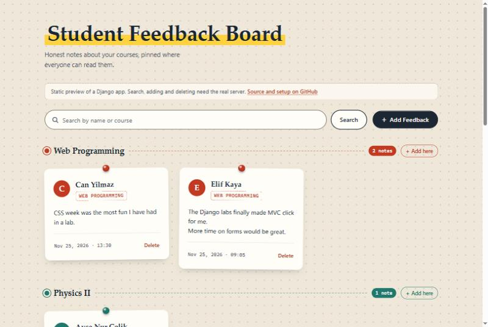
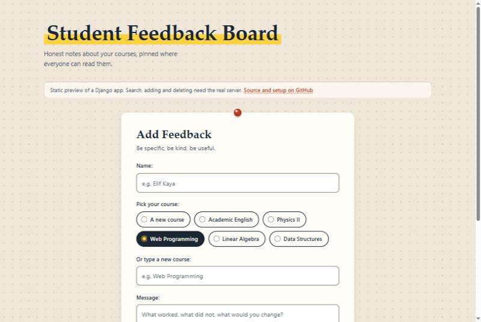
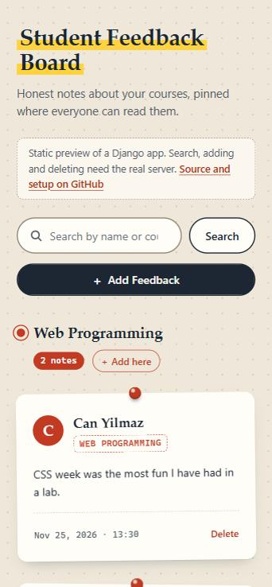
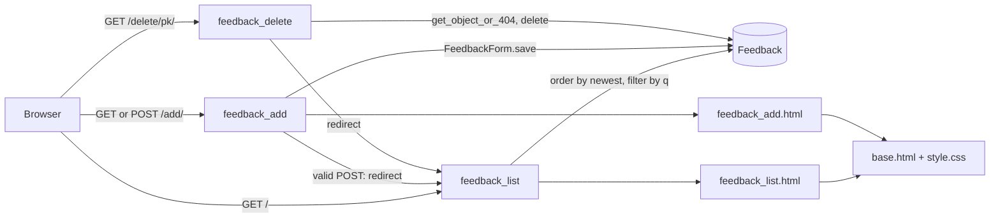
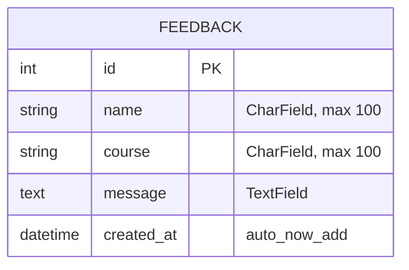
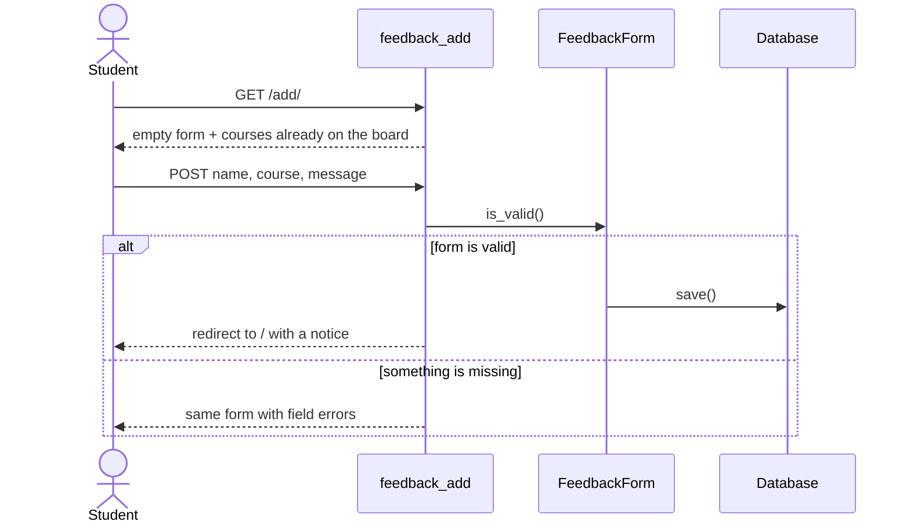
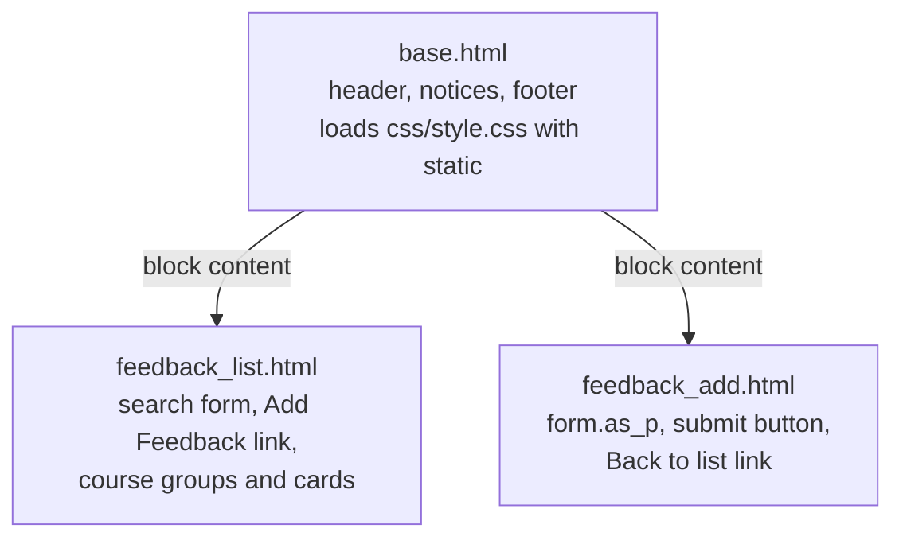

# Student Feedback Board

A small Django application where students leave feedback about their courses and read everyone else's as cards pinned to a board. It is built with Django models, forms, function-based views, templates and one external stylesheet, with **no JavaScript at all**: every animation and interaction is plain HTML and CSS.

**Live preview:** https://mehmetyasinuzun.github.io/student-feedback-board/

The preview is a static snapshot of the real pages, so the layout and animations are the real thing, but searching, adding and deleting need the Django server. See [Run it locally](#run-it-locally).



| Add form | Mobile |
|---|---|
|  |  |

## Contents

- [Features](#features)
- [How it works](#how-it-works)
- [Project structure](#project-structure)
- [Run it locally](#run-it-locally)
- [Tests](#tests)
- [Design notes](#design-notes)
- [Known limits](#known-limits)
- [About](#about)

## Features

- **Submit feedback** with a name, a course and a message. Every field is required and errors are shown next to the field that caused them.
- **Board of cards**, newest first. Each card shows the name, course, message, date and a Delete link.
- **Grouped by course.** Feedback for the same course sits side by side under one heading and shares one colour. Course names are compared without regard to case or extra spaces.
- **Search** with `?q=` over name or course, case-insensitive. The query stays in the search box.
- **Course picker without scripts.** The add form offers the courses already on the board as a radio group: Tab moves into it and the arrow keys pick a course at once. A new course can still be typed.
- **One spelling per course.** A course typed as `web  programming` is saved as the existing `Web Programming`.
- **Responsive** from 320 px phones to wide desktops, with no horizontal scrolling.
- **CSS-only motion:** cards drop onto the board one after another, the title gets a highlighter swipe, buttons fill with colour, errors shake, and notices dismiss themselves. All of it is switched off for people who prefer reduced motion.

## How it works

### Request flow



### URLs

| URL | View | Name | What it does |
|---|---|---|---|
| `/` | `feedback_list` | `feedback_list` | Shows all feedback, newest first. `?q=` filters by name or course. |
| `/add/` | `feedback_add` | `feedback_add` | GET shows an empty form. POST validates, saves and redirects to the list. |
| `/delete/<int:pk>/` | `feedback_delete` | `feedback_delete` | Deletes one entry and redirects to the list. |

### Data model



### Adding feedback



### Template inheritance



### How grouping keeps "newest first"

The view still orders by `-created_at`. Cards are then bucketed by course in that order, so the course with the most recent feedback comes first and, inside a course, the newest card comes first. A new entry is always the first card on the page.

## Project structure

```
student-feedback-board/
├── manage.py
├── requirements.txt
├── feedbackboard/              project settings and root URLs
│   ├── settings.py
│   └── urls.py
├── feedback/                   the app
│   ├── models.py               Feedback model
│   ├── forms.py                FeedbackForm (ModelForm) and the course picker
│   ├── views.py                feedback_list, feedback_add, feedback_delete
│   ├── urls.py                 the three named routes
│   ├── tests.py                40 tests
│   ├── fixtures/sample.json    six sample entries
│   ├── migrations/
│   └── templates/feedback/
│       ├── base.html
│       ├── feedback_list.html
│       └── feedback_add.html
├── static/
│   ├── css/style.css           the only stylesheet
│   └── img/favicon.svg
└── docs/                       static preview served by GitHub Pages
```

## Run it locally

You need Python 3.10 or newer.

```bash
git clone https://github.com/mehmetyasinuzun/student-feedback-board.git
cd student-feedback-board
python -m venv venv
```

Activate the environment: `venv\Scripts\activate` on Windows, `source venv/bin/activate` on macOS and Linux. Then:

```bash
pip install -r requirements.txt
python manage.py migrate
python manage.py loaddata sample
python manage.py runserver
```

Open http://127.0.0.1:8000/. The `loaddata` step is optional; it fills the board with six sample entries.

## Tests

```bash
python manage.py test
```

The 40 tests cover the model fields, required-field validation, newest-first ordering, search by name and by course, grouping by course, the course picker, add and delete flows, the named URLs, HTML escaping of user input and CSRF protection.

## Design notes

- **Pinned index cards.** The board is dotted paper, each card hangs from a pin with a slight tilt, and straightens and lifts when you point at it.
- **No web fonts or external assets.** The page uses system font stacks, so it works offline and loads in one request for CSS.
- **Colour has a job.** Each course gets one accent colour, used for its heading, pins, avatars and tags, so related cards read as a set.
- **Keyboard first.** Everything is reachable with Tab, focus is always visible, and the course picker works with the arrow keys.
- **Accessible defaults.** Text contrast was checked against the card and paper backgrounds, controls are sized for touch, and animations respect `prefers-reduced-motion`.

## Known limits

- **Delete is a plain GET link** with no confirmation. That is what the assignment asks for; a real product would use a POST form and ask first.
- **Search and non-ASCII letters.** On SQLite, `icontains` ignores case for ASCII letters only, so letters such as Ç, Ğ, İ, Ö, Ş, Ü are matched case-sensitively.
- **No accounts.** Anyone can add or delete feedback.
- **Development settings.** `DEBUG` is on and the secret key falls back to a placeholder. Set `DJANGO_SECRET_KEY` and turn `DEBUG` off before deploying anywhere.

## About

Built by **Mehmet Yasin UZUN** as the lab midterm for **CNG 361 - Web Programming** (Fall 2026), taught by Assoc. Prof. Dr. Farhan Aadil.
